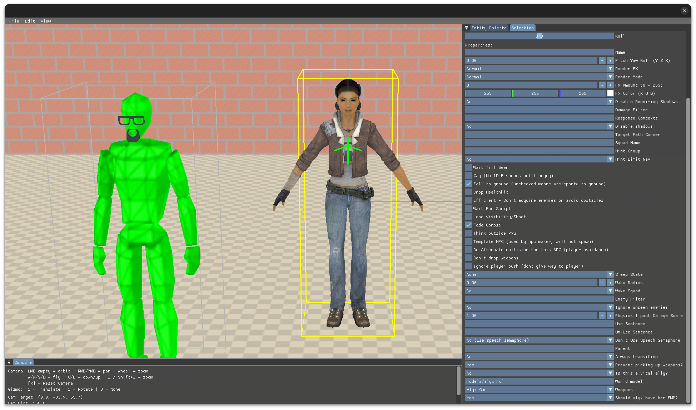
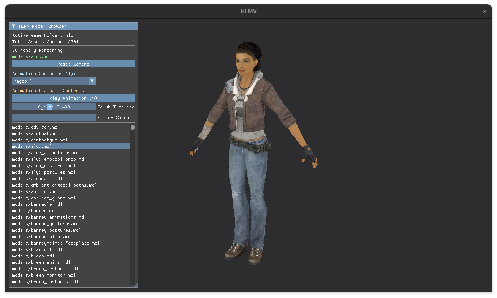

# Source Engine

This project was forked from https://github.com/nillerusr/source-engine, I'm working on linux utilities and hammer editor

### utilities

* hammer (in progress)
* hlmv (in progress)
* glview
* vpk
* vbsp
* vbspinfo
* vvis
* vrad
* studiomdl
* vtex
* dmxconvert
* obj2mdl
* bspzip

### snapshots

# How to Build?
- [Building instructions(EN)](https://github.com/nillerusr/source-engine/wiki/Source-Engine-(EN))
- [Building instructions(RU)](https://github.com/nillerusr/source-engine/wiki/Source-Engine-(RU))

# Support nillerusr
BTC: `bc1qnjq92jj9uqjtafcx2zvnwd48q89hgtd6w8a6na`

ETH: `0x5d0D561146Ed758D266E59B56e85Af0b03ABAF46`

XMR: `48iXvX61MU24m5VGc77rXQYKmoww3dZh6hn7mEwDaLVTfGhyBKq2teoPpeBq6xvqj4itsGh6EzNTzBty6ZDDevApCFNpsJ`
